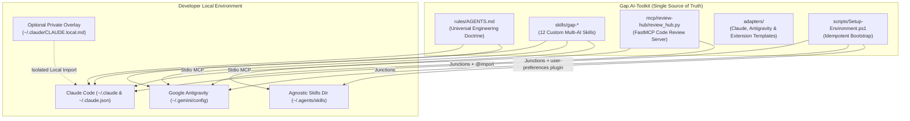
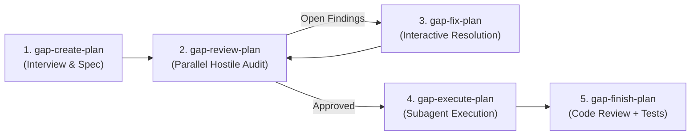

# Gap.AI-Toolkit — Agnostic Agent Architecture, Custom Skills & Multi-AI Orchestration

> **Language / Idioma:** [Português (PT-BR)](./README.md) | **English (EN)**

Central repository for AI-assisted software engineering, multi-agent orchestration, and automated developer environment setup. Engineered to act as a **Single Source of Truth** across multiple AI coding clients — such as **Claude Code** and **Google Antigravity (`agy`)** — combining universal engineering rules, **12 custom-built skills (`gap-*`)**, a **custom Python MCP server (`review-hub`)** for multi-agent Code Review mediation, and idempotent bootstrap scripts.

---

## 1. Overview & Motivation

Modern AI-assisted development environments frequently suffer from **configuration fragmentation**: behavioral rules get locked into vendor-specific files (`CLAUDE.md` vs. `AGENTS.md` vs. `GEMINI.md`), custom skills get duplicated across global folders (`~/.claude/skills`, `~/.gemini/config/skills`, `~/.agents/skills`), and employer-specific context gets tangled with personal engineering workflows.

**`Gap.AI-Toolkit`** solves this through three core design principles:

1. **Agnostic Core (`rules/AGENTS.md` + `skills/gap-*`):** All engineering doctrine, architectural decision protocols, and multi-step workflows are written in a universal format compatible with both Claude Code and Google Antigravity.
2. **Zero-Duplication Linking (`scripts/Setup-Environment.ps1`):** Rather than copying files around manually, the setup script uses Windows *Directory Junctions* and native manifests so any edit to a skill or rule is immediately live across every AI tool on the machine.
3. **Strict Isolation of Private/Corporate Context:** Supports injecting an optional local private overlay (`CLAUDE.local.md`) without polluting the public repository, backed by an automated `pre-commit` security gate that prevents accidental leaks of sensitive or corporate data.

---

## 2. Ecosystem Architecture



---

## 3. Agent Engineering Doctrine ([`rules/AGENTS.md`](./rules/AGENTS.md))

The [`rules/AGENTS.md`](./rules/AGENTS.md) playbook consolidates battle-tested rules for high-complexity software engineering:

- **Inversion of Control & Incremental Architecture:** Agents never guess ambiguous requirements or dump monolithic designs without prior alignment. Architectural decisions are broken down into small steps, presenting side-by-side *trade-off* tables before recommending an option.
- **Shallow Subagent Hierarchy (1-Level):** Strict `coordinator → executor` delegation. Subagents never spawn sub-subagents, follow a semantic `<role>-<task>` naming convention, and are terminated immediately upon completing their task.
- **Context Window Compression:** Heavy codebase exploration is delegated to isolated subagents that return a dense 20–30 line digest with exact `file:line` pointers, keeping the coordinator's context window clean.
- **Multi-Agent Technical Debate (Max 3 Rounds):** Adversarial reviews between agents take place through a structured channel (dedicated file or the `review-hub` MCP server). If an impasse remains after 3 rounds, the decision is escalated to the human engineer with both arguments summarized.
- **Graphify First:** Before running raw text searches (`grep`), agents check for a repository knowledge graph (`graphify-out/graph.json`) to query architecture and call paths structurally.
- **Git Hygiene & Living Documentation:** Repository documentation describes only the current system state (no temporal changelogs); local AI artifacts are isolated via `.git/info/exclude` (never polluting the team's shared `.gitignore`); commits use clean functional messages without `Co-Authored-By` noise.

---

## 4. Catalog of the 12 Custom Skills (`gap-*`)

Every skill follows the open `skills/<name>/SKILL.md` standard and includes cross-platform tool mappings for **Claude Code** and **Google Antigravity**.

### 4.1. Adversarial Planning & Execution Lifecycle (`gap-*-plan`)

A 5-stage engineering pipeline designed to surface hidden assumptions and architectural flaws *before* and *during* implementation:



| Skill | Role in Pipeline |
| :--- | :--- |
| **[`gap-create-plan`](./skills/gap-create-plan/SKILL.md)** | **Adversarial Plan Architect:** Investigates the codebase, conducts an exhaustive Socratic interview with globally numbered questions (zero unverified assumptions), and outputs a self-contained implementation plan (`plano-<name>.md`) using a [structured template](./skills/gap-create-plan/references/plan-template.md). |
| **[`gap-review-plan`](./skills/gap-review-plan/SKILL.md)** | **Hostile Plan Auditor:** Partitions plan auditing across parallel subagents (by technical dimension or phase), tracks findings with stable IDs (`F1`, `F2`...) across review versions (`revisao-<name>-v<N>.md`), and blocks execution until critical flaws are resolved. |
| **[`gap-fix-plan`](./skills/gap-fix-plan/SKILL.md)** | **Interactive Finding Resolver:** Reads the plan and the `gap-review-plan` report, walks the developer through each `OPEN`/`REOPENED` finding, and surgically applies approved fixes to the plan. |
| **[`gap-execute-plan`](./skills/gap-execute-plan/SKILL.md)** | **Disciplined Plan Runner:** Executes an approved `plano-*.md` in a clean session, dispatching fresh subagents per task, verifying acceptance criteria, and updating the *Master Checklist* in-place. |
| **[`gap-finish-plan`](./skills/gap-finish-plan/SKILL.md)** | **Post-Implementation Auditor:** Dispatches parallel subagents for hostile code review against the original plan and full test suite verification, producing a versioned findings report (`findings-<name>-v<N>.md`). |

### 4.2. Hybrid Multi-AI Orchestration

| Skill | Description |
| :--- | :--- |
| **[`gap-fluxo`](./skills/gap-fluxo/SKILL.md)** | **End-to-End Hybrid Orchestrator (Spec-Kit + Claude + Antigravity):** Chains the Spec-Kit workflow (`specify → clarify → plan → tasks → analyze`) and evaluates each task across 4 complexity criteria to route execution dynamically between native Claude Code subagents and **Google Antigravity CLI (`agy`)** connected via `agentchattr`. |

### 4.3. Daily Engineering, Cognitive Ergonomics & Meta-Tooling

| Skill | Description |
| :--- | :--- |
| **[`gap-commit`](./skills/gap-commit/SKILL.md)** | **Safe Commit & Sync Workflow:** Inspects `status`/`diff` to prevent secret leaks, writes a concise functional commit message (imperative summary + functional bullets, no implementation noise, no `Co-Authored-By`), runs safe `pull --rebase`, and pushes (with optional corporate proxy env bypass). |
| **[`gap-pr`](./skills/gap-pr/SKILL.md)** | **Pull Request:** Dynamically detects the base branch, analyzes the full commit log and 3-dot diff, and generates a *Conventional Commits* title and structured Markdown description verified to stay ≤ 4,000 characters via a temporary file check. By default it opens the PR (Azure DevOps via REST API with the environment PAT, or GitHub via `gh`), never duplicating an open PR or pushing without consent; when the request makes it clear, it only generates the text for manual creation. |
| **[`gap-explain`](./skills/gap-explain/SKILL.md)** | **Persistent ADHD-Friendly Technical Explanation Mode:** Adapts the agent's communication style to reduce cognitive fatigue on dense technical topics — provides high-level context before details, makes intermediate reasoning steps explicit, defines jargon on first use, breaks text into short 2–4 line paragraphs without dumbing down content, and closes with a 1–3 sentence synthesis anchor. |
| **[`gap-create-skill`](./skills/gap-create-skill/SKILL.md)** | **Socratic Skill Builder:** Guides an interactive interview (triggers, workflow steps, boundaries, I/O format, auxiliary resources) to turn a raw idea into a standardized `gap-XXXXX` skill. |
| **[`gap-create-subagent`](./skills/gap-create-subagent/SKILL.md)** | **Paired Subagent Builder:** Scaffolds isolated subagents and their companion slash commands applying least-privilege tool restrictions and cost-effective model selection (`haiku`/`sonnet`/`opus` or Antigravity equivalents). |
| **[`gap-switch-claude`](./skills/gap-switch-claude/SKILL.md)** | **Fast Account Switcher (`cswap`):** Rotates the active Claude Code CLI account via `cswap switch` and reports the newly authenticated email. |

---

## 5. Custom MCP Server: `CodeReviewHub` ([`mcp/review-hub/`](./mcp/review-hub/README.md))

Located at [`mcp/review-hub/review_hub.py`](./mcp/review-hub/review_hub.py), **CodeReviewHub** is a custom **Model Context Protocol (MCP)** server built in Python using `FastMCP` to mediate structured code review threads and technical debates between multiple AI agents.

- **Exposed Tools:**
  - `registrar_apontamento(autor, arquivo, linha_ou_trecho, observacao)`: Logs a numbered code review finding.
  - `responder_apontamento(item_id, autor, resposta)`: Appends a reply, counter-argument, or fix confirmation from another agent.
  - `ler_discussao()`: Returns the full discussion thread and replies as structured JSON.
  - `limpar_discussao()`: Resets the discussion state (`~/.review_thread.json`) for a fresh review session.

See the [full `review-hub` documentation](./mcp/review-hub/README.md) for setup details and multi-agent workflow examples.

---

## 6. Repository Structure

```text
Gap.AI-Toolkit/
├── README.md                         # Main documentation (Portuguese)
├── README.en.md                      # Main documentation (English)
├── rules/
│   └── AGENTS.md                     # Universal, AI-agnostic engineering doctrine
├── skills/                           # 12 custom skills (gap-*) for Claude Code & Antigravity
│   ├── gap-commit/
│   ├── gap-create-plan/
│   ├── gap-create-skill/
│   ├── gap-create-subagent/
│   ├── gap-execute-plan/
│   ├── gap-explain/
│   ├── gap-finish-plan/
│   ├── gap-fix-plan/
│   ├── gap-fluxo/
│   ├── gap-pr/
│   ├── gap-review-plan/
│   └── gap-switch-claude/
├── mcp/
│   └── review-hub/                   # Python FastMCP server for multi-agent Code Review
│       ├── review_hub.py
│       ├── requirements.txt
│       └── README.md
├── adapters/                         # Sanitized client templates & 3rd-party extension manifest
│   ├── extensions.json               # Curated catalog of external plugins/skills (superpowers, mattpocock, graphify, caveman)
│   ├── claude/
│   │   ├── CLAUDE.template.md
│   │   └── settings.template.json
│   └── antigravity/
│       ├── plugin.json
│       ├── skills.template.json
│       └── mcp_config.template.json
└── scripts/
    ├── Setup-Environment.ps1         # Idempotent bootstrap & Junction linking script
    ├── Link-WorkspaceAgents.ps1      # Utility to link .agents/AGENTS.md -> CLAUDE.md across workspace repos
    ├── Test-SensitiveData.ps1        # Security scanner against sensitive/corporate data leaks
    └── hooks/
        └── pre-commit                # Git hook blocking commits with sensitive data or corporate emails
```

---

## 7. Quickstart (Bootstrapping a New Machine)

### Prerequisites
- Windows 10/11 with **PowerShell 5.1+** (or PowerShell 7+) and **Git**
- **Python 3.10+** with the `mcp` package installed (`pip install -r mcp/review-hub/requirements.txt`)
- **Claude Code CLI** and/or **Google Antigravity (`agy`)**

### Step 1: Clone & Run Bootstrap
```powershell
git clone https://github.com/Gustavo-Piccoli/Gap.AI-Toolkit.git
cd Gap.AI-Toolkit
powershell -ExecutionPolicy Bypass -File .\scripts\Setup-Environment.ps1
```

`Setup-Environment.ps1` is **100% idempotent** and automatically performs:
1. Installs the security `pre-commit` hook into `.git/hooks/pre-commit`.
2. Creates Windows *Directory Junctions* (`mklink /J`, no Admin privileges required) for all 12 `gap-*` skills inside `~/.claude/skills/`, `~/.gemini/config/skills/`, and `~/.agents/skills/` (first removing orphaned `gap-*` Junctions whose target was renamed or deleted).
3. Configures `~/.claude/CLAUDE.md` to import `rules/AGENTS.md` (while preserving any existing local/corporate overlay such as `~/.claude/CLAUDE.local.md`).
4. Updates Google Antigravity's global `user-preferences` plugin (`~/.gemini/config/plugins/user-preferences/rules/AGENTS.md`).
5. Registers the **`review-hub`** MCP server in both Claude Code (`~/.claude.json`) and Google Antigravity (`~/.gemini/config/mcp_config.json`).

### Step 2 (Optional): Link Existing Workspace Repositories for Antigravity
To ensure all repositories in a project workspace that already have a `CLAUDE.md` are automatically discovered by Google Antigravity (while keeping `git status` clean via `.git/info/exclude`):

```powershell
powershell -ExecutionPolicy Bypass -File .\scripts\Link-WorkspaceAgents.ps1 -WorkspacePath "C:\Path\To\Your\Repositories"
```

---

## 8. Security & Privacy Gate (`pre-commit` & `Test-SensitiveData.ps1`)

Because this toolkit can be used on machines that also work with private or corporate repositories, it ships with two automated security layers:
- **`scripts/Test-SensitiveData.ps1`**: Scans all repository files for internal hostnames, employee IDs, corporate domains, API tokens (`ghp_*`, `sk-ant-*`), or legacy references.
- **`scripts/hooks/pre-commit`**: Blocks any commit if `git config user.email` uses a corporate domain or if `Test-SensitiveData.ps1` flags any violation.
