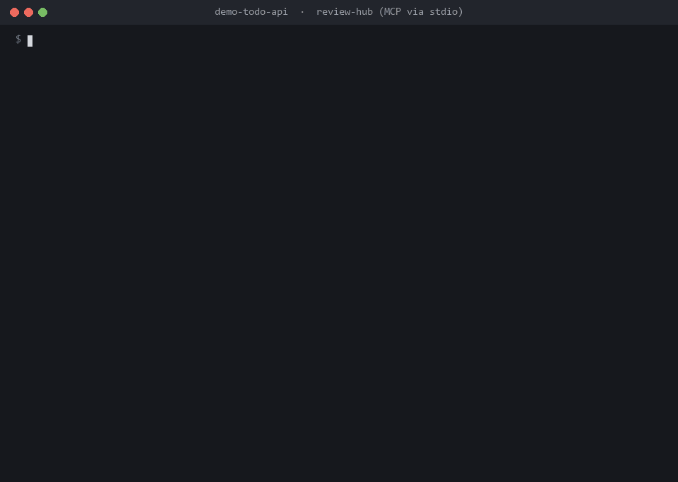
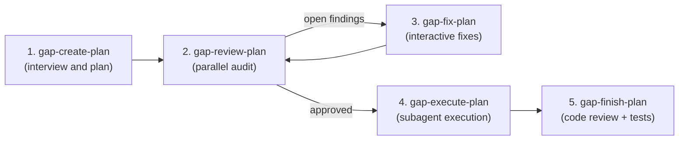

# Gap.AI-Toolkit

[](https://github.com/Gustavo-Piccoli/Gap.AI-Toolkit/actions/workflows/ci.yml)
[](./LICENSE)

> **Language / Idioma:** [Português (PT-BR)](./README.md) | **English**

**What it is:** an engineering toolkit for AI coding agents: working rules in one universal `AGENTS.md`, 12 `gap-*` skills, and a custom MCP server (`review-hub`) that lets two agents review each other's code.
**Who it's for:** developers using **Claude Code** and/or **Google Antigravity** on **Windows** who want the same rules and skills in both clients without copying files around.
**In 2 minutes:** clone the repo, run `scripts\Setup-Environment.ps1`, then type `/gap-create-plan <what you want to build>` in Claude Code.

<!-- DEMO: record a short GIF (~15 s) of the /gap-create-plan → /gap-review-plan cycle, save it as docs/assets/demo.gif and uncomment the line below. -->
<!--  -->

> The skill instructions and the rules file are mostly written in Portuguese (PT-BR); the plans and reports they generate, the docs and the examples are in English.

---

## Highlight: the `review-hub` MCP server

The most verifiable code in this repo is [`mcp/review-hub/review_hub.py`](./mcp/review-hub/review_hub.py), a Python **Model Context Protocol** server built on FastMCP. It gives two agents (for example, Claude Code as implementer and Antigravity as reviewer) a shared review thread through 4 tools: register a finding, reply, read and clear.

- **Safe with concurrent agents:** cross-process file lock (Windows and POSIX) and atomic writes (`tempfile` + `fsync` + `os.replace`).
- **No silent data loss:** corrupted JSON raises an explicit error and the file is left untouched.
- **Configurable:** storage path via the `REVIEW_HUB_STORAGE` environment variable.
- **Tested:** 16 pytest tests, including concurrent writers (threads and processes); CI runs on Ubuntu (Python 3.10 and 3.13) and Windows.

Docs: [server README (PT-BR)](./mcp/review-hub/README.md) · [JSON format](./docs/review-hub-format.md) · [sample thread](./examples/todo-api-rate-limit/review-thread.json).

---

## What's inside

### Universal rules: [`rules/AGENTS.md`](./rules/AGENTS.md)

A single rules file, read by Claude Code (via `@import` in `~/.claude/CLAUDE.md`) and by Antigravity (via the `user-preferences` plugin). It covers:

- asking before assuming requirements, and showing trade-offs before recommending;
- a shallow subagent hierarchy (one level), standard names and shutting down idle agents;
- delegating long reads to subagents that return short summaries with `file:line` pointers;
- agent-to-agent debate capped at 3 rounds, then escalation to the human;
- checking a repository knowledge graph (graphify) before `grep`;
- Git hygiene, docs that describe only the current state, and PowerShell 5.1 encoding pitfalls.

### Adversarial planning cycle (`gap-*-plan`)



| Skill | Role |
| :--- | :--- |
| [`gap-create-plan`](./skills/gap-create-plan/SKILL.md) | Investigates the code, interviews the user with numbered questions and writes a self-contained plan from a [template](./skills/gap-create-plan/references/plan-template.md). |
| [`gap-review-plan`](./skills/gap-review-plan/SKILL.md) | Reviews the plan with parallel subagents and tracks problems with stable IDs (`F1`, `F2`...) across cycles. |
| [`gap-fix-plan`](./skills/gap-fix-plan/SKILL.md) | Discusses each open finding with the user and applies the approved fixes to the plan. |
| [`gap-execute-plan`](./skills/gap-execute-plan/SKILL.md) | Executes an approved plan by dispatching one subagent per task and updating the checklist. |
| [`gap-finish-plan`](./skills/gap-finish-plan/SKILL.md) | Reviews the implementation against the plan, runs the tests and writes a findings report. |

A complete fictional example lives in [`examples/todo-api-rate-limit/`](./examples/todo-api-rate-limit/): the [plan](./examples/todo-api-rate-limit/plano-todo-api-rate-limit.md), the [review report](./examples/todo-api-rate-limit/revisao-todo-api-rate-limit-v1.md) and the [review-hub thread](./examples/todo-api-rate-limit/review-thread.json).

### Other skills

| Skill | Description |
| :--- | :--- |
| [`gap-fluxo`](./skills/gap-fluxo/SKILL.md) | Runs a request end to end with spec-kit and decides, task by task, between a native subagent and the Antigravity CLI (`agy`) via agentchattr. |
| [`gap-commit`](./skills/gap-commit/SKILL.md) | Stage, commit and push with a secrets check, `pull --rebase` and a proxy workaround. |
| [`gap-pr`](./skills/gap-pr/SKILL.md) | Writes a PR title and description from the branch history and opens the PR on GitHub (`gh`) or Azure DevOps (REST). |
| [`gap-explain`](./skills/gap-explain/SKILL.md) | Technical explanation mode in short blocks, designed to reduce cognitive fatigue (ADHD). |
| [`gap-create-skill`](./skills/gap-create-skill/SKILL.md) | Guided interview to create a new `gap-*` skill. |
| [`gap-create-subagent`](./skills/gap-create-subagent/SKILL.md) | Creates subagents with least-privilege tools and a fitting model. |
| [`gap-switch-claude`](./skills/gap-switch-claude/SKILL.md) | Switches the active Claude Code account via `cswap`. |

---

## Original work vs. third-party

| Original (this repository) | Third-party (used or integrated, not included here) |
| :--- | :--- |
| `rules/AGENTS.md` | [superpowers](https://github.com/obra/superpowers) (Claude Code plugin) |
| The 12 `gap-*` skills | [mattpocock/skills](https://github.com/mattpocock/skills) |
| The `review-hub` MCP server | `skill-creator` and `modern-web-guidance` from [anthropics/claude-plugins-official](https://github.com/anthropics/claude-plugins-official) |
| `scripts/` (bootstrap, workspace linking, sensitive-data scanner, hook) | graphify (`graphifyy` on PyPI), used by the "Graphify First" rule |
| `adapters/` (configuration templates) | [spec-kit](https://github.com/github/spec-kit) and agentchattr, used by `gap-fluxo` |
| | caveman (compressed-output skill) and `cswap` (account switcher), used by `gap-switch-claude` |
| | [MCP Python SDK](https://github.com/modelcontextprotocol/python-sdk) (`FastMCP`), the base of `review-hub` |

The catalog of what the bootstrap expects to find is [`adapters/extensions.json`](./adapters/extensions.json); its descriptions come from the tools themselves.

---

## Requirements

The toolkit is **Windows-first**: the bootstrap relies on Directory Junctions and Windows paths. `review-hub` and the scanner run on any OS.

- Windows 10/11 with **Windows PowerShell 5.1** or **PowerShell 7+**
- **Git for Windows** (the `pre-commit` hook runs in its `sh`)
- **Python 3.10+**
- **Claude Code** and/or **Google Antigravity** (`agy`)
- Optional: the third-party plugins and tools above, for the skills that depend on them

## Installation

```powershell
git clone https://github.com/Gustavo-Piccoli/Gap.AI-Toolkit.git
cd Gap.AI-Toolkit
pip install -r mcp/review-hub/requirements.txt
powershell -ExecutionPolicy Bypass -File .\scripts\Setup-Environment.ps1
```

`Setup-Environment.ps1` can be re-run whenever something changes. It:

1. installs the `pre-commit` hook in this repository;
2. creates Junctions for the `gap-*` skills in `~/.claude/skills`, `~/.gemini/config/skills` and `~/.agents/skills` (no admin rights needed) and removes orphaned ones;
3. generates `~/.claude/CLAUDE.md` importing `rules/AGENTS.md` and, if present, local overlays such as `~/.claude/CLAUDE.local.md`;
4. syncs the Antigravity `user-preferences` plugin;
5. registers `review-hub` in Claude Code (`~/.claude.json`) and Antigravity (`~/.gemini/config/mcp_config.json`).

To make Antigravity also read the `CLAUDE.md` of every repository in a projects folder:

```powershell
powershell -ExecutionPolicy Bypass -File .\scripts\Link-WorkspaceAgents.ps1 -WorkspacePath "C:\path\to\repos"
```

---

## Data-leak protection

This repository lives on machines that also access employer environments, so it has two layers of protection:

- **[`scripts/Test-SensitiveData.ps1`](./scripts/Test-SensitiveData.ps1)** scans tracked and new files. Generic rules (GitHub, Anthropic, OpenAI and AWS tokens, private keys) live in the script. Your organization's patterns live **outside the repository**, in a local file:
  - `-PatternsFile <path>`, or the `GAP_SENSITIVE_PATTERNS_FILE` variable, or `%USERPROFILE%\.config\gap-toolkit\sensitive-patterns.txt`;
  - `Category<TAB>Regex` format, as in [`sensitive-patterns.example.txt`](./scripts/sensitive-patterns.example.txt) (fictional values).

  The scanner never prints the matched value, only file, line and category, and it also catches literals split by concatenation (`'ab' + 'cd'`).
- **[`scripts/hooks/pre-commit`](./scripts/hooks/pre-commit)** runs the scanner before every commit and blocks it if `git user.email` matches a local pattern (for example, your company domain).

---

## Layout

```text
Gap.AI-Toolkit/
├── rules/AGENTS.md                  # universal rules for the agents
├── skills/gap-*/                    # 12 skills (Claude Code and Antigravity)
├── mcp/review-hub/                  # Python MCP server + tests + pyproject.toml
├── adapters/                        # configuration templates and extensions catalog
├── scripts/                         # bootstrap, workspace linking, scanner and hook
├── docs/                            # review-hub format and JSON Schema
├── examples/todo-api-rate-limit/    # fictional plan, review and thread
└── .github/workflows/ci.yml         # ruff, pytest, PSScriptAnalyzer and secret scan
```

## Development

```bash
cd mcp/review-hub
pip install -e ".[dev]"
python -m pytest -v
ruff check . && ruff format --check .
```

```powershell
Invoke-ScriptAnalyzer -Path .\scripts -Recurse -Settings .\PSScriptAnalyzerSettings.psd1
.\scripts\Test-SensitiveData.ps1 -PatternsFile .\scripts\sensitive-patterns.example.txt -RequirePatternsFile
```

Release history is in the [CHANGELOG](./CHANGELOG.md).

## License

[MIT](./LICENSE) © Gustavo Auad Piccoli
