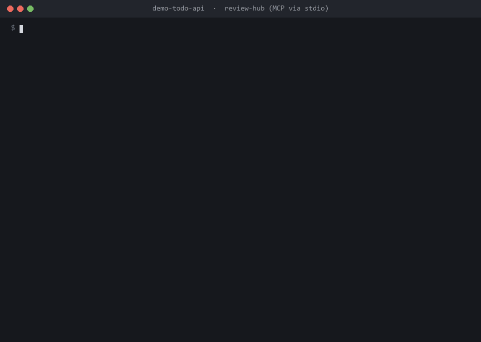
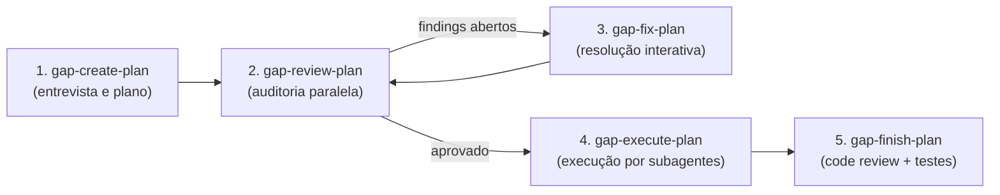

# Gap.AI-Toolkit

[](https://github.com/Gustavo-Piccoli/Gap.AI-Toolkit/actions/workflows/ci.yml)
[](./LICENSE)

> **Idioma / Language:** **Português (PT-BR)** | [English](./README.en.md)

**O que é:** um toolkit de engenharia com agentes de IA: regras de trabalho num `AGENTS.md` universal, 12 skills `gap-*` e um servidor MCP próprio (`review-hub`) para dois agentes revisarem o código um do outro.
**Para quem:** quem usa **Claude Code** e/ou **Google Antigravity** no **Windows** e quer as mesmas regras e skills nos dois clientes, sem copiar arquivos.
**Em 2 minutos:** clone o repositório, rode `scripts\Setup-Environment.ps1` e, no Claude Code, digite `/gap-create-plan <o que você quer construir>`.

<!-- DEMO: grave um GIF curto (~15 s) do ciclo /gap-create-plan → /gap-review-plan, salve em docs/assets/demo.gif e descomente a linha abaixo. -->
<!--  -->

---

## Destaque: servidor MCP `review-hub`

O código mais verificável do repositório é o [`mcp/review-hub/review_hub.py`](./mcp/review-hub/review_hub.py), um servidor **Model Context Protocol** em Python (FastMCP). Ele dá a dois agentes (por exemplo, Claude Code como implementador e Antigravity como revisor) uma thread de revisão compartilhada, com 4 tools: registrar apontamento, responder, ler e limpar.

- **Seguro com vários agentes ao mesmo tempo:** lock de arquivo entre processos (Windows e POSIX) e escrita atômica (`tempfile` + `fsync` + `os.replace`).
- **Sem perda silenciosa de dados:** JSON corrompido gera erro explícito e o arquivo não é tocado.
- **Configurável:** caminho do armazenamento pela variável `REVIEW_HUB_STORAGE`.
- **Testado:** 16 testes com pytest, incluindo escrita concorrente por threads e por processos; o CI roda em Ubuntu (Python 3.10 e 3.13) e Windows.

Documentação: [README do servidor](./mcp/review-hub/README.md) · [formato do JSON](./docs/review-hub-format.md) · [exemplo de thread](./examples/todo-api-rate-limit/review-thread.json).

---

## O que tem aqui

### Regras universais: [`rules/AGENTS.md`](./rules/AGENTS.md)

Um único arquivo de regras, lido pelo Claude Code (via `@import` no `~/.claude/CLAUDE.md`) e pelo Antigravity (via plugin `user-preferences`). Cobre:

- perguntar antes de assumir requisitos e apresentar trade-offs antes de recomendar;
- hierarquia rasa de subagentes (um nível), nomes padronizados e encerramento de agentes ociosos;
- delegar leituras longas a subagentes que devolvem resumos curtos com `arquivo:linha`;
- debate entre agentes limitado a 3 rodadas, com escalonamento para o humano;
- consultar um grafo de conhecimento do repositório (graphify) antes de `grep`;
- higiene de Git, documentação que descreve só o estado atual e cuidados com encoding no PowerShell 5.1.

### Ciclo de planejamento adversarial (`gap-*-plan`)



| Skill | Papel |
| :--- | :--- |
| [`gap-create-plan`](./skills/gap-create-plan/SKILL.md) | Investiga o código, entrevista o usuário com perguntas numeradas e gera um plano autocontido a partir de um [template](./skills/gap-create-plan/references/plan-template.md). |
| [`gap-review-plan`](./skills/gap-review-plan/SKILL.md) | Revisa o plano com subagentes em paralelo e rastreia problemas com IDs estáveis (`F1`, `F2`...) entre ciclos. |
| [`gap-fix-plan`](./skills/gap-fix-plan/SKILL.md) | Discute cada finding aberto com o usuário e aplica as correções aprovadas no plano. |
| [`gap-execute-plan`](./skills/gap-execute-plan/SKILL.md) | Executa um plano aprovado despachando subagentes por tarefa e atualizando o checklist. |
| [`gap-finish-plan`](./skills/gap-finish-plan/SKILL.md) | Revisa a implementação contra o plano, roda os testes e gera um relatório de findings. |

Exemplo fictício completo em [`examples/todo-api-rate-limit/`](./examples/todo-api-rate-limit/): o [plano](./examples/todo-api-rate-limit/plano-todo-api-rate-limit.md), o [relatório de revisão](./examples/todo-api-rate-limit/revisao-todo-api-rate-limit-v1.md) e a [thread do review-hub](./examples/todo-api-rate-limit/review-thread.json).

### Outras skills

| Skill | Descrição |
| :--- | :--- |
| [`gap-fluxo`](./skills/gap-fluxo/SKILL.md) | Orquestra um pedido de ponta a ponta com spec-kit e decide, tarefa a tarefa, entre subagente nativo e Antigravity CLI (`agy`) via agentchattr. |
| [`gap-commit`](./skills/gap-commit/SKILL.md) | Stage, commit e push com checagem de segredos, `pull --rebase` e contorno de proxy. |
| [`gap-pr`](./skills/gap-pr/SKILL.md) | Gera título e descrição de PR a partir do histórico da branch e cria a PR no GitHub (`gh`) ou no Azure DevOps (REST). |
| [`gap-explain`](./skills/gap-explain/SKILL.md) | Modo de explicação técnica em blocos curtos, pensado para reduzir fadiga cognitiva (TDAH). |
| [`gap-create-skill`](./skills/gap-create-skill/SKILL.md) | Entrevista guiada para criar uma nova skill `gap-*`. |
| [`gap-create-subagent`](./skills/gap-create-subagent/SKILL.md) | Cria subagentes com privilégio mínimo de tools e escolha de modelo. |
| [`gap-switch-claude`](./skills/gap-switch-claude/SKILL.md) | Troca a conta ativa do Claude Code via `cswap`. |

---

## O que é autoral e o que é de terceiros

| Autoral (este repositório) | De terceiros (usado ou integrado, não incluído aqui) |
| :--- | :--- |
| `rules/AGENTS.md` | [superpowers](https://github.com/obra/superpowers) (plugin do Claude Code) |
| As 12 skills `gap-*` | [mattpocock/skills](https://github.com/mattpocock/skills) |
| Servidor MCP `review-hub` | `skill-creator` e `modern-web-guidance`, de [anthropics/claude-plugins-official](https://github.com/anthropics/claude-plugins-official) |
| `scripts/` (bootstrap, vínculo de workspaces, scanner de dados sensíveis, hook) | graphify (pacote `graphifyy` no PyPI), usado pela regra "Graphify First" |
| `adapters/` (templates de configuração) | [spec-kit](https://github.com/github/spec-kit) e agentchattr, usados pela `gap-fluxo` |
| | caveman (skill de saída comprimida) e `cswap` (troca de contas), usado pela `gap-switch-claude` |
| | [MCP Python SDK](https://github.com/modelcontextprotocol/python-sdk) (`FastMCP`), base do `review-hub` |

O catálogo do que o bootstrap espera encontrar está em [`adapters/extensions.json`](./adapters/extensions.json). As descrições lá são das próprias ferramentas.

---

## Requisitos

O toolkit é **Windows-first**: o bootstrap usa *Directory Junctions* e caminhos do Windows. O `review-hub` e o scanner rodam em qualquer sistema.

- Windows 10/11 com **Windows PowerShell 5.1** ou **PowerShell 7+**
- **Git for Windows** (o hook `pre-commit` roda no `sh` dele)
- **Python 3.10+**
- **Claude Code** e/ou **Google Antigravity** (`agy`)
- Opcional: os plugins e ferramentas de terceiros da tabela acima, para as skills que dependem deles

## Instalação

```powershell
git clone https://github.com/Gustavo-Piccoli/Gap.AI-Toolkit.git
cd Gap.AI-Toolkit
python -m venv mcp\review-hub\.venv
mcp\review-hub\.venv\Scripts\python -m pip install -r mcp\review-hub\requirements.txt
powershell -ExecutionPolicy Bypass -File .\scripts\Setup-Environment.ps1
```

O `Setup-Environment.ps1` pode ser rodado de novo sempre que algo mudar. Ele:

1. instala o hook `pre-commit` neste repositório;
2. cria Junctions das skills `gap-*` em `~/.claude/skills`, `~/.gemini/config/skills` e `~/.agents/skills` (sem exigir administrador) e remove Junctions órfãs; com `-RemoveLegacyGustavoSkills $true`, também retira as skills legadas `gustavo-*` (pastas reais são movidas para `skills-legacy-backup\<data-hora>`, ao lado da pasta de skills, em vez de apagadas);
3. gera o `~/.claude/CLAUDE.md` importando `rules/AGENTS.md` e, se existirem, overlays locais como `~/.claude/CLAUDE.local.md` (o arquivo é **reescrito**: se você já tem instruções no seu `~/.claude/CLAUDE.md`, mova-as para um overlay antes de rodar);
4. sincroniza o plugin `user-preferences` do Antigravity;
5. registra o `review-hub` no `mcpServers` da raiz do Claude Code (`~/.claude.json`) e do Antigravity (`~/.gemini/config/mcp_config.json`), usando o Python de `mcp\review-hub\.venv` quando ela existir.

Para que o Antigravity também leia o `CLAUDE.md` de cada repositório de uma pasta de projetos:

```powershell
powershell -ExecutionPolicy Bypass -File .\scripts\Link-WorkspaceAgents.ps1 -WorkspacePath "C:\caminho\dos\repositorios"
```

---

## Proteção contra vazamento de dados

O repositório convive em máquinas que também acessam ambientes de empresa, então há duas camadas de proteção:

- **[`scripts/Test-SensitiveData.ps1`](./scripts/Test-SensitiveData.ps1)** varre os arquivos versionados e os novos. As regras genéricas (tokens do GitHub, Anthropic, OpenAI, AWS e chaves privadas) ficam no script. Os padrões da sua organização ficam **fora do repositório**, num arquivo local:
  - `-PatternsFile <caminho>`, ou a variável `GAP_SENSITIVE_PATTERNS_FILE`, ou `%USERPROFILE%\.config\gap-toolkit\sensitive-patterns.txt`;
  - formato `Categoria<TAB>Regex`, como no [`sensitive-patterns.example.txt`](./scripts/sensitive-patterns.example.txt) (valores fictícios).

  O scanner nunca imprime o valor encontrado, só arquivo, linha e categoria, e também detecta literais quebrados por concatenação (`'ab' + 'cd'`).
- **[`scripts/hooks/pre-commit`](./scripts/hooks/pre-commit)** roda o scanner antes de cada commit e bloqueia o commit se o `git user.email` casar com algum padrão local (por exemplo, o domínio da empresa).

---

## Estrutura

```text
Gap.AI-Toolkit/
├── rules/AGENTS.md                  # regras universais para os agentes
├── skills/gap-*/                    # 12 skills (Claude Code e Antigravity)
├── mcp/review-hub/                  # servidor MCP em Python + testes + pyproject.toml
├── adapters/                        # templates de configuração e catálogo de extensões
├── scripts/                         # bootstrap, vínculo de workspaces, scanner e hook
├── docs/                            # formato e JSON Schema do review-hub
├── examples/todo-api-rate-limit/    # plano, revisão e thread fictícios
└── .github/workflows/ci.yml         # ruff, pytest, PSScriptAnalyzer e varredura de segredos
```

## Desenvolvimento

```bash
cd mcp/review-hub
pip install -e ".[dev]"
python -m pytest -v
ruff check . && ruff format --check .
```

```powershell
Invoke-ScriptAnalyzer -Path .\scripts -Recurse -Settings .\PSScriptAnalyzerSettings.psd1
.\scripts\Test-SensitiveData.ps1 -PatternsFile .\scripts\sensitive-patterns.example.txt -RequirePatternsFile
```

O histórico de versões está no [CHANGELOG](./CHANGELOG.md).

## Licença

[MIT](./LICENSE) © Gustavo Auad Piccoli
