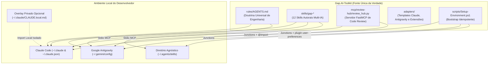
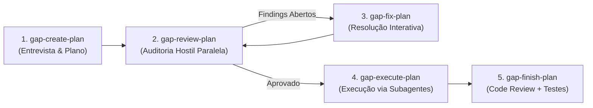

# Gap.AI-Toolkit — Arquitetura Agnóstica de Agentes, Skills e Orquestração Multi-IA

> **Idioma / Language:** **Português (PT-BR)** | [English (EN)](./README.en.md)

Repositório central de engenharia assistida por IA, orquestração multi-agente e automação de ambiente de desenvolvimento. Projetado para funcionar como **Fonte Única da Verdade (Single Source of Truth)** entre múltiplos clientes de IA — como **Claude Code** e **Google Antigravity (`agy`)** — combinando regras universais de arquitetura, **12 skills autorais (`gap-*`)**, um **servidor MCP próprio em Python (`review-hub`)** para mediação de Code Review entre agentes e scripts de bootstrap automatizado.

---

## 1. Visão Geral e Motivação

Ambientes modernos de desenvolvimento assistido por IA frequentemente sofrem de **fragmentação**: regras de comportamento ficam presas em arquivos específicos de um único fornecedor (`CLAUDE.md` vs. `AGENTS.md` vs. `GEMINI.md`), skills são duplicadas entre pastas globais (`~/.claude/skills`, `~/.gemini/config/skills`, `~/.agents/skills`) e configurações corporativas acabam misturadas com preferências pessoais de engenharia.

O **`Gap.AI-Toolkit`** resolve esse problema através de três pilares:

1. **Núcleo Agnóstico (`rules/AGENTS.md` + `skills/gap-*`):** Toda a doutrina de engenharia, protocolos de decisão arquitetural e fluxos de trabalho vivem em formato universal compatível tanto com Claude Code quanto com Google Antigravity.
2. **Ligação Zero-Duplicação (`scripts/Setup-Environment.ps1`):** Em vez de copiar arquivos manualmente, o ambiente utiliza *Directory Junctions* e manifestos nativos para que qualquer melhoria feita em uma skill ou regra reflita instantaneamente em todas as IAs instaladas na máquina.
3. **Isolamento Estrito de Contexto Privado/Corporativo:** Suporta a injeção opcional de um overlay privado local (`CLAUDE.local.md`) sem contaminar o repositório público, protegido por um guardião `pre-commit` automatizado contra vazamento de dados sensíveis.

---

## 2. Arquitetura do Ecossistema



---

## 3. Doutrina de Engenharia com Agentes ([`rules/AGENTS.md`](./rules/AGENTS.md))

O arquivo [`rules/AGENTS.md`](./rules/AGENTS.md) consolida diretrizes práticas testadas em projetos reais de alta complexidade:

- **Inversão de Controle e Decisões Incrementais:** O agente nunca assume requisitos implícitos nem despeja arquiteturas monolíticas prontas sem validação. Decisões arquiteturais são fatiadas em passos pequenos, apresentando tabelas de *trade-offs* entre abordagens candidatas antes de recomendar um caminho.
- **Hierarquia Rasa de Subagentes (1 Nível):** Orquestração disciplinada (`coordenador → executor`), proibindo árvores recursivas de sub-subagentes, exigindo nomenclatura semântica (`<papel>-<tarefa>`) e encerramento imediato de agentes ociosos.
- **Compressão de Contexto:** Leituras exploratórias extensas são delegadas a subagentes isolados que devolvem ao coordenador um resumo denso de no máximo 20–30 linhas contendo ponteiros exatos `arquivo:linha`.
- **Debate Técnico Multi-Agente (Máx. 3 Rodadas):** Revisões adversariais entre agentes ocorrem via canal estruturado (arquivo dedicado ou servidor MCP `review-hub`). Se após 3 rodadas de réplica/tréplica restar impasse, a decisão é escalada ao engenheiro humano com os argumentos de ambos os lados.
- **Graphify First:** Antes de buscas textuais brutas (`grep`), o agente verifica a existência de um grafo de conhecimento do repositório (`graphify-out/graph.json`) para navegar pela arquitetura com precisão estrutural.
- **Higiene de Git e Documentação Viva:** Documentação de repositório descreve apenas o estado atual do sistema (sem changelogs temporais obsoletos); artefatos locais de IA são isolados via `.git/info/exclude` (sem poluir o `.gitignore` da equipe); commits seguem padrão funcional limpo sem trailers `Co-Authored-By`.

---

## 4. Catálogo das 12 Skills Autorais (`gap-*`)

Todas as skills seguem o padrão aberto `skills/<nome>/SKILL.md` e incluem mapeamento de ferramentas compatível com **Claude Code** e **Google Antigravity**.

### 4.1. Ciclo Adversarial de Planejamento e Execução (`gap-*-plan`)

Um pipeline completo de 5 estágios projetado para eliminar suposições ocultas e bugs arquiteturais antes e durante a codificação:



| Skill | Papel no Pipeline |
| :--- | :--- |
| **[`gap-create-plan`](./skills/gap-create-plan/SKILL.md)** | **Arquiteto Adversarial de Planos:** Investiga o código-fonte, conduz entrevista exaustiva com perguntas numeradas globalmente sem assumir premissas, e gera um plano autocontido (`plano-<nome>.md`) seguindo [template estruturado](./skills/gap-create-plan/references/plan-template.md). |
| **[`gap-review-plan`](./skills/gap-review-plan/SKILL.md)** | **Auditor Hostil de Planos:** Particiona a revisão do plano em subagentes paralelos (por dimensão técnica ou fase), rastreia problemas com IDs estáveis (`F1`, `F2`...) entre versões (`revisao-<nome>-v<N>.md`) e impede avanço enquanto houver falhas críticas. |
| **[`gap-fix-plan`](./skills/gap-fix-plan/SKILL.md)** | **Resolvedor Interativo de Apontamentos:** Lê o plano e o relatório do `gap-review-plan`, debate cada *finding* aberto (`OPEN`/`REOPENED`) com o desenvolvedor e aplica cirurgicamente as correções aprovadas. |
| **[`gap-execute-plan`](./skills/gap-execute-plan/SKILL.md)** | **Executor Disciplinado:** Executa um `plano-*.md` aprovado em sessão limpa, despachando subagentes por tarefa, validando critérios de aceite e atualizando o *Master Checklist* in-place. |
| **[`gap-finish-plan`](./skills/gap-finish-plan/SKILL.md)** | **Auditor Pós-Implementação:** Dispara subagentes paralelos para *code review* hostil da implementação real contra o plano e execução da suíte de testes, gerando relatório consolidado (`findings-<nome>-v<N>.md`). |

### 4.2. Orquestração Híbrida Multi-IA

| Skill | Descrição |
| :--- | :--- |
| **[`gap-fluxo`](./skills/gap-fluxo/SKILL.md)** | **Orquestrador Ponta a Ponta (Spec-Kit + Claude + Antigravity):** Encadeia as etapas do Spec-Kit (`specify → clarify → plan → tasks → analyze`) e avalia cada tarefa por critérios objetivos de complexidade/contexto para roteá-la entre subagentes nativos do Claude Code ou execução via **Google Antigravity CLI (`agy`)** integrado pelo barramento `agentchattr`. |

### 4.3. Produtividade Diária, Cognição e Meta-Engenharia

| Skill | Descrição |
| :--- | :--- |
| **[`gap-commit`](./skills/gap-commit/SKILL.md)** | **Fluxo Seguro de Commit & Sync:** Inspeciona `status`/`diff` prevenindo commit de segredos, redige mensagem funcional em PT-BR (resumo imperativo + bullets sem detalhes internos e sem `Co-Authored-By`), executa `pull --rebase` seguro e `push` (com suporte a contorno de variáveis de proxy corporativo). |
| **[`gap-pr`](./skills/gap-pr/SKILL.md)** | **Pull Request:** Detecta dinamicamente a branch base, analisa o histórico completo de commits e diffs da branch e gera título (*Conventional Commits*) e descrição estruturada em Markdown, validando o limite de 4.000 caracteres via arquivo temporário. Por padrão cria a PR (Azure DevOps via REST API com o PAT do ambiente, ou GitHub via `gh`), sem duplicar PR já aberta e sem push sem aceite; se o pedido deixar claro, gera só o texto para criação manual. |
| **[`gap-explain`](./skills/gap-explain/SKILL.md)** | **Modo Persistente de Explicação Técnica (Adaptado para TDAH):** Altera o estilo comunicativo do agente para reduzir fadiga cognitiva em leituras técnicas densas — contextualiza o "porquê" antes do "como", explicita saltos intermediários de raciocínio, define jargões no primeiro uso, fatia em blocos curtos (2–4 linhas) sem infantilizar e fecha com uma âncora de síntese. |
| **[`gap-create-skill`](./skills/gap-create-skill/SKILL.md)** | **Construtor Socrático de Skills:** Conduz uma entrevista estruturada (gatilhos, passo a passo, restrições, formato de I/O e recursos auxiliares) para transformar uma ideia em uma nova skill padronizada `gap-XXXXX`. |
| **[`gap-create-subagent`](./skills/gap-create-subagent/SKILL.md)** | **Construtor Pareado de Subagentes:** Cria subagentes especializados aplicando o princípio do privilégio mínimo na seleção de *tools* e escolha adequada de modelo (`haiku`/`sonnet`/`opus` ou equivalentes no Antigravity). |
| **[`gap-switch-claude`](./skills/gap-switch-claude/SKILL.md)** | **Rotação Rápida de Conta (`cswap`):** Alterna a conta ativa do Claude Code CLI via `cswap switch` e confirma o usuário autenticado. |

---

## 5. Servidor MCP Autoral: `CodeReviewHub` ([`mcp/review-hub/`](./mcp/review-hub/README.md))

Localizado em [`mcp/review-hub/review_hub.py`](./mcp/review-hub/review_hub.py), o **CodeReviewHub** é um servidor **Model Context Protocol (MCP)** construído em Python com `FastMCP` para viabilizar sessões estruturadas de revisão de código e debate técnico entre diferentes agentes de IA.

- **Tools expostas:**
  - `registrar_apontamento(autor, arquivo, linha_ou_trecho, observacao)`: Registra um achado de revisão numerado.
  - `responder_apontamento(item_id, autor, resposta)`: Registra réplica, contra-argumento ou confirmação de correção de outro agente.
  - `ler_discussao()`: Retorna toda a árvore de apontamentos e réplicas em JSON estruturado.
  - `limpar_discussao()`: Reinicia o estado da thread (`~/.review_thread.json`) para uma nova rodada de revisão.

Consulte a [documentação completa do `review-hub`](./mcp/review-hub/README.md) para exemplos de uso e detalhes de protocolo.

---

## 6. Estrutura do Repositório

```text
Gap.AI-Toolkit/
├── README.md                         # Documentação principal (Português)
├── README.en.md                      # Documentação principal (Inglês)
├── rules/
│   └── AGENTS.md                     # Doutrina universal e agnóstica de engenharia com IA
├── skills/                           # 12 skills autorais (gap-*) compatíveis com Claude e Antigravity
│   ├── gap-commit/
│   ├── gap-create-plan/
│   ├── gap-create-skill/
│   ├── gap-create-subagent/
│   ├── gap-execute-plan/
│   ├── gap-explain/
│   ├── gap-finish-plan/
│   ├── gap-fix-plan/
│   ├── gap-fluxo/
│   ├── gap-pr/
│   ├── gap-review-plan/
│   └── gap-switch-claude/
├── mcp/
│   └── review-hub/                   # Servidor MCP em Python (FastMCP) para Code Review multi-agente
│       ├── review_hub.py
│       ├── requirements.txt
│       └── README.md
├── adapters/                         # Templates sanitizados para clientes de IA e manifesto de extensões
│   ├── extensions.json               # Catálogo de plugins/skills de terceiros (superpowers, mattpocock, graphify, caveman)
│   ├── claude/
│   │   ├── CLAUDE.template.md
│   │   └── settings.template.json
│   └── antigravity/
│       ├── plugin.json
│       ├── skills.template.json
│       └── mcp_config.template.json
└── scripts/
    ├── Setup-Environment.ps1         # Script idempotente de bootstrap e ligação via Junctions
    ├── Link-WorkspaceAgents.ps1      # Utilitário para vincular .agents/AGENTS.md -> CLAUDE.md em workspaces
    ├── Test-SensitiveData.ps1        # Scanner de segurança contra vazamento de dados sensíveis/corporativos
    └── hooks/
        └── pre-commit                # Git hook que bloqueia commits com dados sensíveis ou e-mail corporativo
```

---

## 7. Como Configurar um Novo Ambiente (Quickstart)

### Pré-requisitos
- Windows 10/11 com **PowerShell 5.1+** (ou PowerShell 7+) e **Git**
- **Python 3.10+** com pacote `mcp` instalado (`pip install -r mcp/review-hub/requirements.txt`)
- **Claude Code CLI** e/ou **Google Antigravity (`agy`)**

### Passo 1: Clonar e Executar o Bootstrap
```powershell
git clone https://github.com/Gustavo-Piccoli/Gap.AI-Toolkit.git
cd Gap.AI-Toolkit
powershell -ExecutionPolicy Bypass -File .\scripts\Setup-Environment.ps1
```

O script `Setup-Environment.ps1` é **100% idempotente** e realiza automaticamente:
1. Instalação do hook `pre-commit` de segurança no repositório.
2. Criação de *Directory Junctions* (`mklink /J`, sem exigir privilégio de Administrador) de todas as 12 skills `gap-*` em `~/.claude/skills/`, `~/.gemini/config/skills/` e `~/.agents/skills/` (removendo antes as Junctions `gap-*` órfãs, cujo destino foi renomeado ou apagado).
3. Configuração do `~/.claude/CLAUDE.md` apontando para `rules/AGENTS.md` (e preservando qualquer overlay corporativo/local existente, como `~/.claude/CLAUDE.local.md`).
4. Atualização do plugin global `user-preferences` do Antigravity (`~/.gemini/config/plugins/user-preferences/rules/AGENTS.md`).
5. Registro automático do servidor MCP **`review-hub`** tanto no Claude Code (`~/.claude.json`) quanto no Antigravity (`~/.gemini/config/mcp_config.json`).

### Passo 2 (Opcional): Vincular Repositórios de um Workspace ao Antigravity
Para fazer com que todos os repositórios de uma pasta de projetos que já possuam `CLAUDE.md` também sejam lidos automaticamente pelo Antigravity (sem sujar o `git status`, via `.git/info/exclude`):

```powershell
powershell -ExecutionPolicy Bypass -File .\scripts\Link-WorkspaceAgents.ps1 -WorkspacePath "C:\Caminho\Para\Seus\Repositorios"
```

---

## 8. Segurança e Privacidade (`pre-commit` & `Test-SensitiveData.ps1`)

Como este repositório convive em máquinas que também acessam ambientes corporativos, ele inclui duas camadas de proteção automática:
- **`scripts/Test-SensitiveData.ps1`**: Varre todos os arquivos versionados em busca de padrões corporativos, matrículas, hostnames internos, tokens de API (`ghp_*`, `sk-ant-*`) ou referências legadas.
- **`scripts/hooks/pre-commit`**: Impede qualquer commit caso o `user.email` do Git pertença a domínio corporativo ou caso o scanner detecte qualquer padrão sensível.
